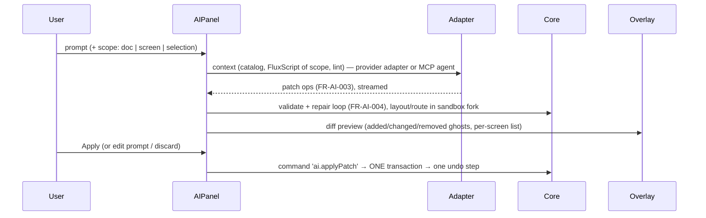

# 04 — Rendering & Editor (`@fluxion/render`, `@fluxion/editor`, `apps/studio`)

> Read when: touching `<ScreenView>`, an element view, theming in rendered content, measurement,
> culling, the edit overlay, a tool, snapping, the inspector, clipboard, the AI panel, the studio
> shell, or anything that affects edit/present parity or drag performance.
> Research basis: `research/01` §2 (layering, camera, culling), §3.4 (tools), §4.4 (text), §5.3
> (decorations), §7.3 (key decisions); `research/03` §8.1 (frame rules). Requirements: `15-editor.md`,
> FR-CMP-*, NFR-PERF-001/002/006, NFR-SIZE-001/002. Frames, paths, tables and masters: ADR-0052, ADR-0053, ADR-0054
> (§2.7, §3.9).

## 1. Responsibilities

| Package | Owns | Never does |
|---|---|---|
| `render` (L3) | Drawing one screen from store signals + an optional animation state; element view registry; CSS variables from theme; text measurement adapter; culling | Handle pointer gestures, mutate the store, own time |
| `editor` (L4) | Overlay chrome, tools FSM, hit-testing, snapping, camera, inspector, panels, palette, keymap, clipboard, AI panel, animation preview (via `player`) | Draw content (it mounts `<ScreenView>`); import `player` internals beyond its public API |
| `apps/studio` | Routing, file open/save, PWA, autosave, provider adapters, wiring registries & packs | Business logic (lives in packages) |

## 2. `@fluxion/render`

### 2.1 Layer stack and the hybrid decision

```
<div class="fx-screen" style="--fx-*: …">          ← CSS vars from theme; fit/camera transform
 ├─ layer: background   CSS/SVG (fills, gradients, images, master-screen elements)
 ├─ layer: content      one positioned wrapper per element, stacked by fractional index
 │    ├─ .fx-el[data-el-id] (shape)      <svg> outline+decorations │ <div> rich text regions
 │    ├─ .fx-el (connector)              <svg> path+markers+hops   │ <div> HTML labels
 │    ├─ .fx-el (component)              <div> React component (error boundary)
 │    └─ .fx-el (group/frame)            <div> clip container, children nested
 ├─ layer: riders       <canvas> (pointer-events:none), used above the DOM-rider threshold (07 §4.3)
 ├─ layer: overlays     popups/popovers/<dialog> roots, presenter ink & laser (player)
 └─ slot:  editOverlay  editor-supplied SVG in screen coordinates (absent in present/export)
```

**Decision: absolutely-positioned DOM wrappers, each with its own small `<svg>`; no
`foreignObject` in the live renderer.** Rationale:

- *Z-order interleaving*: shapes and connectors mix freely in one stacking context ordered by
  fractional index (tldraw model, research 01 §2.2). A single connector SVG would force z-bands.
- *Text & components*: rich text and React components sit in real HTML — browser line breaking,
  bidi, selection, contentEditable, a11y — without `foreignObject`'s known issues (Safari
  transform/filter bugs, clipping, rasterization).
- *Compositing*: each wrapper is promotable, so WAAPI can animate `transform`/`opacity` on the
  compositor (research 03 §8.1 rule 1). An SVG `<g>` would animate on the main thread.
- *Export*: the SVG exporter (FR-EXP-004) serializes each wrapper into a nested `<svg>` and turns
  text regions into `<foreignObject>` or outlined `<text>` (with the Node measurer). The
  `foreignObject` path lives **only** in the export serializer.

The cost is one DOM subtree per element. At the target scale (hundreds to ~2k elements,
NFR-PERF-002) memoized views plus culling keep that within budget (§5).

### 2.2 Public API

The R0 API as built (M4; `packages/render/api/render.api.md` is the snapshot):

```ts
type RenderMode = 'edit' | 'present' | 'export' | 'thumbnail';
function modePolicy(mode: RenderMode): ModePolicy;   // editOverlay, interactive, measure, showHidden, placeholderHints (a master's unfilled placeholders, edit only: ADR-0054)

interface ScreenViewProps {
  store: Store; screenId: RecordId; mode: RenderMode;
  view: { kind: 'fit'; box: { w: number; h: number } };
  theme?: Theme;                          // default LIGHT_THEME; its tokens become --fx-* variables
  registries?: RenderRegistries;          // default builtinRegistries()
  editOverlay?: ReactNode;                // mounted in edit only (mode policy)
  children?: ReactNode;                   // extra content above the elements
}
function ScreenView(props: ScreenViewProps): ReactNode;
function DocumentView(props: { store; mode; box; theme?; registries? }): ReactNode;  // every screen, in order

interface ElementViewProps { element: ElementRecord; store: Store; theme: Theme; registries: RenderRegistries; children?: ReactNode }
interface ElementView { Component: ComponentType<ElementViewProps> }   // must be pure: same record, same markup
interface RenderRegistries { elementViews: Registry<string, ElementView>; shapeDefs: Registry<string, ShapeDef> }  // core's ShapeDef (ADR-0016)
function createRenderRegistries(shapeDefs?: Registry<string, ShapeDef>): RenderRegistries;  // no views; the host's shapeDefs
function registerBuiltinViews(r: RenderRegistries): void;  // shape, connector (source `core`)
function builtinRegistries(shapeDefs?: Registry<string, ShapeDef>): RenderRegistries;  // shapes from the host's packs (ADR-0017)

function renderDocumentToHtml(file: DocumentFile, options?: { screens?; theme?; registries? }): { html: string; screens: RecordId[] };  // ADR-0015; subpath `@fluxion/render/ssr` (ADR-0026)
function normalizeSvg(html: string): string;              // the goldens' normal form (NFR-REL-005)
```

Also exported: the built-in views (`ShapeView`, `ConnectorView`, `PlaceholderView`, `ElementList`),
`CONTENT_CSS`, `useValue` (a React view of a core signal) and the pure helpers `fitTransform`,
`screenArea`, `screensInOrder`, `elementsInOrder`, `connectorEnds`, `paintCss`, `pathData`,
`plainParagraphs`. Render ships no shape definitions: a host passes its core `shapeDefs` registry, where
its packs registered (ADR-0016 item 7, ADR-0017), and the shape view draws `evaluateOutline` of the
element's definition, size and params (an unknown or failing definition is the placeholder).

Planned additions, each with the milestone that needs it:

- `view: { kind: 'camera'; camera }`, `breakpoint` (FR-RSP-003), `cull` (§2.5) — editor and responsive
  milestones;
- `animState` (structure-level animation state from `@fluxion/anim`) and `handles`: an
  `ElementHandle { id, root, geometry?, setStyleVar, setAttr }` sink for per-frame writes that bypass
  React (research 03 §8.1 rule 10) — the player milestones;
- on `ElementView`: `kind`, `measure(el, measurer)` (intrinsic size for autoSize/layout), `a11y(el)`,
  `exportSvg(el, ctx)` and `cull: 'hide' | 'unmount' | 'never'`; a `css` string of view content CSS;

`elementViews` (and later `components`) are render-level registries (03 §4). Packs register views
the same way third parties do; an unknown kind renders a placeholder that keeps its record (FR-DOC-005,
FR-EXT-008). Component views will receive the FR-CMP-002 contract (`props`, tokens, `mode`, step,
variables, `emit`) and be wrapped in an error boundary (FR-CMP-007, NFR-REL-004).

### 2.3 Styling

- `theme` emits a flat CSS-variable map (`--fx-color-primary`, `--fx-font-body`, …) onto
  `.fx-screen`. Per-screen theme overrides re-emit on that screen only (FR-THM-004).
- Views read **resolved styles**: `theme`'s `resolveStyle` (resolution order in 02 §2), wrapped
  per element in a core `computed` by `render` (core may not import theme; ADR-0015). Token refs
  become `var(--fx-…)`, with no value of their own, and `<ScreenView>` hands views the theme keyed
  on `styleKey` (its structure), so a change of token values restyles without re-rendering views
  (ADR-0015 amendment, M5.13). Image fills draw only from the host's `assets` URLs (an
  `AssetUrls` prop); an asset's external `source` is never fetched by a page on its own (NFR-PORT-002).
- Content CSS: strings of `fx-`-prefixed rules in `@layer fx.content` (render's content CSS plus
  each registered view's `css`), inlined by SSR and injected once in the browser (ADR-0015);
  Tailwind never reaches content (ADR-0010). Identical CSS in all modes is a precondition for parity.

### 2.4 Measurement

`TextMeasurer` port (03 §7). The browser implementation measures with canvas/Pretext first and
verifies with a batched DOM read in a hidden measuring root, only for `autoSize` text and
shrink-to-fit. It waits for `document.fonts.ready` and caches by `(text hash, fontKey, maxWidth)`.
Results are derived data (a signal cache), never written to records except when a command bakes
a size (e.g., grow-shape). Component views may report size and dynamic anchors through
`useFluxion().reportAnchors()` (FR-ANC-008).

### 2.5 Culling & spatial index

A per-screen `SpatialIndex` (03 §6) is kept by `core`: `rbush` while editing, and `flatbush`
built once for player/export. `<ScreenView>` queries the visible page box (camera box plus a
margin) each frame when the camera changes. Out-of-view wrappers get `content-visibility:hidden`
(`cull:'hide'`) or unmount (`'unmount'`). Fit views that show the whole screen skip culling.

M16.18 measured without culling first (`e2e/perf.big-screen.spec.ts`, 2,000 shapes and 1,000 orthogonal
connectors): the camera is a transform on `.fx-screen` and no element view re-renders while panning or
zooming, so both hold 60 fps. Culling is therefore not built; it waits for a measurement that needs it.
The first render was over budget, and the fixes were on the open path:
- the editor's hit index builds lazily (`prepare` runs when the page is idle);
- shape path templates are parsed once per text;
- the nearest-point search skips outline segments whose box is farther than the best point found.

Together these bring the first render from about 1.0-1.2 s to about 0.75 s.

### 2.6 One renderer, two modes: parity

Mode differences are an allow-list, enforced by a lint rule that permits reading `mode` only in
`render/src/mode-policy.ts`:

| Concern | edit | present |
|---|---|---|
| Component pointer events | captured by editor unless entered/`interactiveInEdit` | live |
| Build-hidden elements | final state by default; preview toggle uses `animState` (FR-ANI-011) | `animState` |
| Comments, hidden-layer ghosts | editor overlay only | absent |
| Focus/tab order, ARIA live region | off | on (NFR-A11Y-002) |

**Parity tests (FR-EDT-010):** a Playwright fixture set renders each screen at a given
`(step, t)` in edit mode (empty selection, overlay slot unmounted) and in present mode. Two checks:
(1) the serialized DOM of the `content` layer is equal after stripping an attribute allow-list,
and (2) the pixel diff is ≤ 0.1 %. Any failure blocks the gate.

### 2.7 Frames, paths, tables and masters (M19)

Each is drawn by the same element views in edit, present and export (ADR-0015), so parity holds without a per-mode path.

- **Frames** (FR-ARR-006, ADR-0052): `container-views.tsx` nests a frame's members in a `<div>` clipped to its box, rounded by
  the resolved corner radius, unless `clip: false`. The clip turns with the frame. `padding` draws nothing.
- **Path shapes** (FR-SHP-010, FR-SHP-011, ADR-0053): a `core:path` shape draws its `path.d` scaled from `path.w × path.h` to the
  element's box, with its `fillRule`; outlines go through `path-data.ts` (coordinates rounded to 1/1000 px).
- **Tables** (FR-SHP-014, ADR-0054): `table-layout.ts` gives each row and column its share of the box from its weight, each drawn
  cell's box (spans cover the cells right and below) and the style a cell resolves: its own `style`, over the table style's part for
  its row (header, band), over the `cell` and `border` parts, over the theme's defaults. A table style the theme does not name falls
  back to the built-in `plain`, `banded` or `grid`. `table-view.tsx` draws each cell with its rich text; a border is centred on the
  edge, so neighbours share one line.
- **Masters** (FR-SCR-005, ADR-0054): `master-view.tsx` is the screen's master layer, under its own elements: the master's
  background unless the screen has one, then the master's elements that are not placeholders and not filled (none with
  `hideMasterElements`). Where `modePolicy` sets `placeholderHints` (edit only), each unfilled placeholder draws a dashed hint with its
  name. The layer is derived from the store (`appliedMaster`, `masterLayers` in core), so editing a master redraws every screen that
  uses it. Masters are skipped by present mode, navigation and export page lists.

## 3. `@fluxion/editor`

### 3.1 Event pipeline

```
pointer/keyboard/wheel (one listener per type on the viewport)
   │ normalize: PointerInfo {screenPt, pagePt = camera⁻¹(screenPt), buttons, mods, pressure}
   ▼
hit-test: overlay handles first (screen space) → rbush candidates near pagePt
          → geometry test per candidate (outline, stroke tolerance ∝ 1/zoom, z-order)
   ▼
tool FSM (current state node) ── emits ──▶ commands (core) ──▶ store.transact(mergeKey)
   │                                                   │ diff
   └── session store (core signals, ADR-0028): hover, selection, camera, snap guides ◀──┘ render + overlay
```

Hit-testing uses geometry, not `elementFromPoint`, so rotated shapes, thin strokes and hollow
shapes work (research 01 §2.3). Components hit-test as their bounds.

### 3.2 Tools: hand-rolled statecharts

```ts
interface StateNode {
  id: string; children?: Record<string, StateNode>; initial?: string;
  onEnter?(ctx: ToolCtx, info?: unknown): void; onExit?(ctx: ToolCtx): void;
  onPointerDown?(ctx: ToolCtx, e: PointerInfo): Transition | void;
  onPointerMove?(ctx: ToolCtx, e: PointerInfo): Transition | void;
  onPointerUp?(ctx: ToolCtx, e: PointerInfo): Transition | void;
  onKeyDown?(ctx: ToolCtx, e: KeyInfo): Transition | void;
  onCancel?(ctx: ToolCtx): Transition | void;           // Esc, pointercancel, blur
}
type Transition = { to: string; info?: unknown };
```

`select` = `idle → pointing → {translating | brushing | resizing | rotating | dragging_handle |
editing_text | entered_component}`. `connector` = `idle → pointing → creating → (snapping to
anchor)`. There are also `hand`, `shape`, `text`, `frame`, `pen`, `freehand` and `image`
(FR-EDT-003). Tools are registered in the `tools` registry. XState is avoided on the hot path;
modal flows such as AI sessions may use plain reducers.

### 3.3 Overlay, camera, snapping

- **Overlay** is one SVG in screen coordinates on top of `<ScreenView>`. It draws selection
  bounds, 8 resize handles and a rotate handle, connector endpoint/segment/waypoint handles, anchor
  dots on hover (FR-ANC-006), smart guides with distance labels, the marquee, drop targets and the
  AI diff ghosts. Handle size stays constant because they sit outside the scaled content. If it
  profiles hot, it moves to Canvas2D behind the same API.
- **Camera** `{x, y, z}` lives in the session store, with z from 0.05 to 32 (FR-EDT-002). One CSS
  transform on the content container. Present mode uses a fit transform.
- **Snapping engine** (FR-ARR-005): pure, and unit-tested without the DOM.

```ts
interface SnapQuery { moving: Box[]; kind: 'move' | 'resize' | 'endpoint'; zoom: number; disabled: boolean }
interface SnapResult { delta: Vec2; guides: Guide[]; anchor?: { elementId: RecordId; anchor: AnchorRef } }
interface SnapProvider { id: string; candidates(q: SnapQuery, idx: SpatialIndex): SnapCandidate[] }
// built-in providers: grid, edges/centers, equal-gaps, screen safe-area, anchors, rotation steps
```

The threshold is `8px / zoom`. Candidates come from rbush in the moving box plus the threshold.
The lowest-distance candidate wins per axis, and Alt bypasses snapping.

**Anchor snap** (FR-ANC-006, FR-ANC-003; M16.17) is not a provider of the box snapping engine: a connector end has no box. `editor/src/anchor-snap.ts` gives the element's anchors as dots (its own, its definition's, the defaults; never its centre, nor one that floats toward the other end) and the one a drop snaps to:
- It is the nearest anchor within `8px / zoom` that is not full.
- An anchor is full when connectors other than the one being dropped fill its `max` (ADR-0043's `maxConnections`).
- A drop farther than that from every free anchor, or on the shape's middle, binds `auto`.

The connector tool and the end handle drag both use it. An end just outside every outline still binds to the nearby element whose anchor it is within the tolerance of (`endTarget`), because the anchors sit on the outline and the hit margin is narrower than the tolerance. From the press, and while a dragged end is over an element, the overlay draws that element's dots (`data-anchor-dot`), marks the snapped one (`data-snapped`) and dims the full ones (`data-full`).

An anchor another element hides is left out (M16.30): no dot, no snap. `HitIndex.covers` asks the spatial index for the elements over a small box around the anchor, and the anchor is hidden when one painted above its element (not hidden, not a connector) holds the anchor and the points `3px / zoom` around it inside its outline (a neighbour's thin stroke along a shared edge does not hide it). The tools get it through `ToolCtx.covered`; an end over the covering shape then binds that shape `auto`.

### 3.4 Inspector, panels, palette, keymap

- **Inspector generated from schemas** (FR-EDT-008). Zod schemas in `schema` carry UI metadata via
  `.meta({ ui: 'token-color' | 'slider' | 'enum-icons' | …, group, order })`. A generator walks
  the schema and renders field widgets. For multi-selection it intersects fields and shows a
  mixed state, and applying a value writes all selected in one command. Plugins register
  `inspectors` to replace or extend sections for their kinds, and plugin `props` schemas get
  generated UI for free.
- **Panels** (screens, library, layers, timeline, interactions, validation, source, AI) register
  in `panels` with slot and order. Layout persists per user (FR-EDT-001).
- **Command palette** lists every `commands` entry whose `when` passes (FR-EDT-011).
  **Keymap** = `{ key: 'mod+shift+l', command: 'element.align', args?, when? }[]`. Defaults come
  from packs and user overrides from local settings (FR-EDT-012). The `?` key opens the
  generated cheat sheet.

**Anchors in the inspector** (FR-ANC-006, FR-ANC-005; M16.25). With one shape selected, the inspector lists its anchors by name (`editor/src/anchor-inspector.ts`): its own, its definition's, then the defaults. Its own (custom) anchors show their place across and down the box (0 to 1) and can be moved or removed; "Add anchor" adds `a1`, `a2`... on the right side. Each change is one `element.updateMany` of the shape's `anchors`, so one undo step, and it is saved with the file. A connector end bound to a removed anchor floats on the outline.
### 3.4a Inline text editing (FR-TXT-003, ADR-0064)

Double-click, Enter or F2 on the one selected element with text opens it in place (`session.editing`).
Both kinds of element open in the same editor: a `shape`'s text (the text tool places a
`basic:text-box`, which grows with its text) and a `kind: 'text'` element's, however it came (a paste,
an import, a hand-written file — TextView draws it). The editor is a ProseMirror view (loaded in the
editor bundle only; the player has none) laid over the element exactly where its label is drawn: the
same box and style (`labelBox` in render), the content CSS and the camera and the element's turn, with
the element's own label hidden. `pm-json.ts` maps ADR-0013's stored JSON to ProseMirror's and back so
that load then save is the identity (a node or mark this version does not know travels whole). Esc, or
focus leaving, commits: one `element.update` with the text and, for a `grow` shape, the height
`grownHeight` says it needs — one transaction, so one undo step; an edit with no change writes
nothing. Until then ProseMirror's own history undoes the typing; the document's history sees one step.

### Screen duplication (FR-SCR-002, ADR-0175)

The screens navigator passes an optional endpoint reader to `duplicateArgs`. For copied
connectors whose outside bindings are omitted, `screens-tab.tsx` resolves the existing route
through its store and render registries and supplies the exact source/target point, including
non-centre anchors. Missing geometry is left absent so core refuses atomically; no centre is
invented. Internal bindings and already-free ends need no supplied point. The screen switches
only after command success; one undo step restores the original records and screen.

### 3.5 Clipboard (FR-EDT-007, ADR-0020)

```ts
interface ClipboardPayload {
  fluxion: 'clipboard'; version: 1; schemaVersion: string; sourceDocId: string;
  records: AnyRecord[];                  // elements + internal bindings + referenced step anims (opt.)
  assets: { hash: string; mime: string; size: number; dataUrl?: string }[];  // inline if ≤ 1 MB, else by hash
  themeTokens?: Record<string, string>;  // resolved fallbacks for cross-doc paste
  bounds: Box;
}
```

In code: `clipboard.ts` (the payload, remapping, the in-editor clipboard), `clipboard-format.ts` (JSON, HTML, text, and the validation of a payload read back), `clipboard-dom.ts` (events, the async API, the inert template parse) and `use-system-clipboard.ts` (the window's copy, cut and paste events, and the menu commands). On copy the editor writes every representation in one operation (ADR-0020). The keyboard copy
event writes a custom `application/x-fluxion+json` `DataTransfer` type. A menu copy makes one async
`ClipboardItem`, with `web application/x-fluxion+json` where supported. Both also write `text/html`
(rendered SVG plus the payload in `<template data-fluxion>`, parsed inertly with `DOMParser` on
paste) and `text/plain` (the text in reading order; FluxScript for a whole screen from M12). Paste
tries the custom type, then the template, then the newest copy of the origin's open editor pages
when the paste carries exactly that copy's text and no file (`clipboard-share.ts`, a
BroadcastChannel: an engine may keep only text/plain, ADR-0213), then image, SVG and text, and
validates the payload as an opened file. It then remaps IDs
through the `Random` port, keeps bindings whose both ends were copied, turns the others into free
endpoints, and offsets by +16 px per repeated paste. System paste also accepts SVG (sanitized,
NFR-SEC-001), images (asset + image element), and Mermaid or Markdown text (importers,
FR-IMP-001/002).

### 3.6 Component elements in edit mode (FR-CMP-004)

The component wrapper gets `pointer-events:none` and `inert` unless
`session.enteredId === id` (entered by double-click or Enter) or the kind declares
`interactiveInEdit`. When entered, the overlay shows an "editing component" frame, and Esc or a
click outside exits. Component state that must persist goes through commands on `props`
(FR-CMP-005).

### 3.7 AI panel (FR-EDT-014)



The preview runs on a copy-on-write **store fork** (`store.fork()`: reads fall through, writes
are local). The main document stays untouched until Apply. The fork's diff drives the ghost
overlay and a textual change list.

### 3.8 Animation preview (FR-ANI-011, FR-EDT-009)

The editor creates a `player` `PresentationController` bound to the same store with a
**controlled clock** (07 §4.8). The timeline panel's scrubber calls `seek({step, t})`, "Play
step" runs the clock, and the result flows into `<ScreenView animState handles>`. The editor
shows the final state by default. Present in place (F5) swaps the root tool set to the player
input layer and puts the store in read-only mode (a policy guard rejects commands, FR-PRS-004).
As built in M6 (M6.20): the edit chrome unmounts, the present-mode tools (the laser) take the
pointer, and their commands go through a read-only guard that refuses every write; the edit keys go
with the canvas. The store's own `read-only` policy is fixed at creation, so it stays for hosts that
open a document read-only (the player).

### 3.9 Structured diagramming (M19)

Every edit below is one command, so one undo step (ADR-0014); opening or closing a master only switches the shown screen. Gestures
(drags, quick-connect, border resizes) and the arrange panel's buttons run the same core commands as the palette entries.

- **Frames** (FR-ARR-006, ADR-0052): the `frame` tool (`F`) draws one. A frame's resize handle resizes its box only (a group's
  still scales its members). When a pointer drag ends, `dropReparents` (core) moves each dragged element whose centre lies in the
  deepest frame under it into that frame, or out to the next container. Hit-testing and the marquee honour clipping
  (`frame-clip.ts`): a member is hit, or touched by a marquee, only inside every clipping frame above it.
- **Layers panel** (FR-ARR-008): `layers-model.ts` and `layers-tab.tsx` list the shown screen's elements as a tree, front first,
  members under their group or frame. A drag among siblings is one `element.reorder` (only the moved record's index changes);
  Alt+ArrowUp/ArrowDown steps an element; the Hide button toggles `hidden` and the lock toggle sets `position`, `size`, `rotation` and
  `select` together, so a locked element stays put and the canvas does not pick it (the panel still does).
- **Locks and flips** (FR-SHP-008, FR-SHP-009): the select tool respects each lock (position through drags and nudges, size
  through resize handles, rotation through the rotate handle, aspect as Shift does, select through clicks, marquee and select-all).
  Flip horizontally and vertically mirror the transform; a frame's flip carries its members (ADR-0052).
- **Text regions and icon slots** (FR-SHP-007, ADR-0054): a double-click edits the region under it (the first is the element's
  `text`, the rest its `texts`); the inspector fills or empties an icon slot. `region-problems.ts` reports entries nothing draws.
- **Booleans and the path tool** (FR-SHP-010, FR-SHP-011, ADR-0053): `boolean-edit.ts` resolves each selected operand's outline,
  placed by its transform, and core replaces the operands by one `core:path` shape (Union, Subtract, Intersect, Exclude). "Edit path"
  (`path-edit.ts`, `path-edit-states.ts`) shows a path shape's vertices and bezier handles; an edit rewrites `d` and refits `w`, `h`
  and the transform so the points that did not move stay put.
- **Tables** (FR-SHP-014, ADR-0054): `table-edit.ts` picks a cell with a click on a selected table (Shift extends the range); the
  table commands insert and delete rows and columns, merge and split; Tab and Shift+Tab step the picked cell; a drag on an inner
  border resizes the rows or columns beside it (`table-resize.ts`). The grid maths is core's (`table-ops.ts`).
- **Masters** (FR-SCR-005, ADR-0054): the navigator lists masters in their own section and its menu makes a screen a master, uses
  one or drops it; "Make placeholder" names a master's element a placeholder; a double-click on a placeholder hint fills it on that
  screen; "Edit master" opens the shown screen's master and "Close master" goes back (`master-edit.ts`). `master-problems.ts` reports
  a master that does not apply and a `fills` with nothing to fill.
- **Match size and the format painter** (FR-ARR-007): the arrange panel matches width, height or both to a key element its
  picker chooses among the selection (`element.matchSize`; arrange panel only, no palette entry). Core's `element.pasteStyle` copies `style`
  only, never `semantic`; its editor UI is backlog row M19.40.
- **Quick-connect** (FR-EDT-015): a hovered shape shows a "+" beyond each side; a drag from one draws a connector, dropped on an
  element it joins the two, dropped on nothing it opens the mini library whose choice adds a joined shape (`quick-connect.ts`).
- **Find** (FR-EDT-016): Ctrl/Cmd+F opens the find bar; `find-model.ts` finds elements by their text (regions and table cells
  included), name or semantic label across screens in navigator order; Enter and Shift+Enter step through matches.

## 4. Studio app shell

- **Routes**: `/` (library, recents), `/edit/:docId`, `/present/:docId#/screen/step`,
  `/open?src=<url>`. Speaker view is `/present/:docId?view=speaker`.
- **File handling** (FR-FIL-006..008): File System Access API with a download fallback. The PWA
  manifest `file_handlers` plus `launchQueue` open `.flux` and `.flux.html` files.
  Drag-and-drop, paste, and `?src=` also work. Autosave goes to OPFS/IndexedDB via the `FileIO`
  port every ≤ 5 s with atomic swap and last-N snapshots (NFR-REL-001).
- **PWA**: a precaching service worker for the app shell, packs and fonts. The editor works
  fully offline, and lazy chunks (ELK, libavoid, Lottie) are cached on first use.
- **Provider adapters** (FR-AI-007): Anthropic, OpenAI, and OpenAI-compatible/local sit behind one
  `AiProvider { stream(req): AsyncIterable<Chunk> }`. Keys stay in local storage only
  (NFR-SEC-004). An MCP live link is an alternative source of patches.
- **Bootstrapping**: create the store, load packs (register kinds, views, tools, commands),
  migrate and validate the document, then mount `EditorRoot` or `PlayerRoot`.

## 5. Performance strategy

| Technique | Where | Effect |
|---|---|---|
| Signal granularity: one signal per record, plus per-element computeds (resolved style, world transform, outline, route) | core/render | A change touches O(dependents), not the screen |
| Memoized element views keyed by record identity; React Compiler on all packages | render | Unchanged elements never re-render |
| **Transform-only drags**: while translating, only the wrapper `transform` changes; inner SVG/text depend on `w,h,style` and stay memoized | render/editor | No inner re-render during move |
| rAF batching: pointermoves coalesce (`getCoalescedEvents`), one merged transaction per frame (`mergeKey`), and React commits once per frame | editor/core | ≤ 1 store diff and 1 commit per frame |
| Affected-only re-route via the bindings index; the cheap router pass during drag, nudging on drop | routing (05 §9) | FR-RTE-002 |
| Culling (§2.5, held until measured), `content-visibility`, lazy panels; a lazily built hit index, templates parsed once, a pruned nearest-point search (M16.18) | render/editor/core/geometry | NFR-PERF-002 |
| Per-frame animation writes through `ElementHandle`, never React state | player | NFR-PERF-004 |
| Debug overlay: FPS, render counts, route/layout timings (NFR-OBS-001) | editor | Regressions visible |

Budgets: 500-element drag ≥ 55 fps (NFR-PERF-001), 2k elements + 1k connectors pan/zoom ≥ 50
fps (NFR-PERF-002), and undo < 16 ms (NFR-PERF-006). Each has a benchmark in the nightly perf job.
The player core stays ≤ 150 kB gz because `render` + `player` never import editor-only
dependencies (NFR-SIZE-001).

## 6. Testing

- `render`: Vitest browser mode for views, Storybook/Playwright visual snapshots per element
  kind, the parity suite (§2.6), and SVG export round-trip.
- `editor`: tool FSMs unit-tested with synthetic `PointerInfo` streams (no DOM), snapping
  property tests, clipboard round-trip across two documents, Playwright E2E per FR-EDT ID, and
  a present-mode fuzz test asserting that the document is unchanged (FR-PRS-004).
